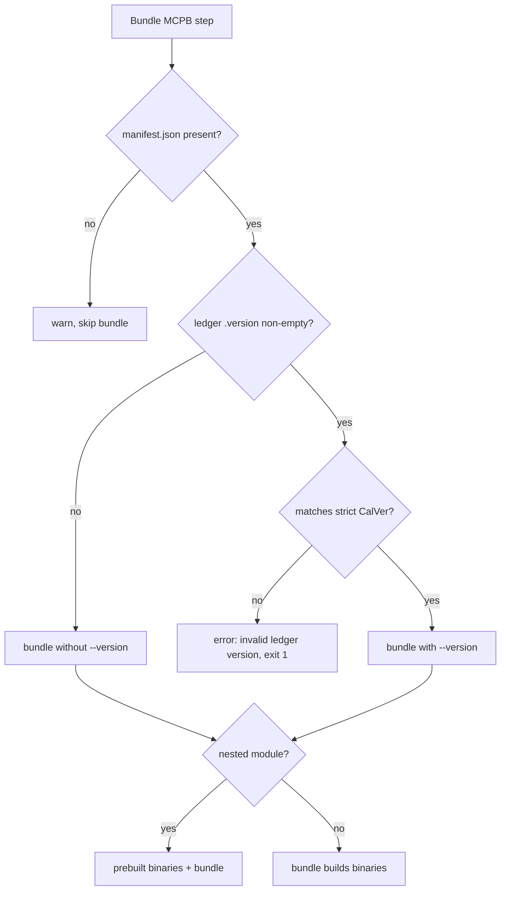

# MCPB Bundle Release Version - Plan

## Goal Capsule

- **Objective:** A Claude Desktop user who installs a `.mcpb` from a `<slug>-current` release sees that CLI's release version (for example `2026.9.2`), not a stale placeholder like `0.1.0`.
- **Means:** pass the CLI's ledger version to `cli-printing-press bundle --version` in the `build-mcpb.yml` bundle step (KTD1).
- **Authority:** this plan, then `AGENTS.md` (release ledger and supply-chain sections).
- **Stop conditions:** stop if the installed bundler rejects valid CalVer, or if the change would alter which CLIs produce a bundle.
- **Execution profile:** one workflow edit, verified by lint, the supply-chain scan, and a dispatched build after merge.

---

## Product Contract

### Summary

The bundle step reads `.version` from the CLI's `.printing-press-release.json` and passes it to `cli-printing-press bundle --version`, on both the root-module path and the nested-module prebuilt path.

### Problem Frame

Every `.mcpb` manifest carries whatever `version` sits in the library `manifest.json`. On main, 134 bundles say `0.1.0`, 83 say `0.0.0`, and the rest carry old generator versions such as `4.33.10`. espn's bundle says `1.2.1` while its CLI is `2026.9.2`. Users can't tell which release a bundle came from, and the number never changes between releases. The bundler gained a `--version` flag for this in cli-printing-press #2817, but `build-mcpb.yml` never passes it.

### Requirements

- R1. A bundle built for a CLI whose ledger has a valid version carries that version in its manifest.
- R2. A CLI with no ledger file, or a ledger with no `version`, still bundles, using the manifest's own version.
- R3. A ledger version that isn't strict CalVer fails the bundle step with an error naming the CLI and the value.
- R4. Nested-module CLIs (`library/ai/v0`) get the same version stamp as root-module CLIs.

### Key Decisions

- **Version source is `.printing-press-release.json` `.version`.** (session-settled: user-approved — chosen over the library `manifest.json` `version`: the ledger is the release identity the release job already checks binaries against.) Governs R1, R4.
- **No backfill rebuild.** (session-settled: user-approved — chosen over rebuilding ~300 CLIs: the number isn't worth that churn; each CLI's next release picks it up.)

### Scope Boundaries

- Considered and not built: a readback check that unzips the bundle and compares its manifest version. The bundler validates and rewrites the version itself, and a failed readback would skip the whole CLI release. Revisit if a bundler release ever changes `--version` behavior.
- Considered and not built: distinguishing stamped from unstamped runs in logs beyond the existing step output. The missing-ledger path is defensive; every bundling CLI on main has a ledger today.
- Local bundles and `bundle-audit.yml` keep the manifest version. They don't publish releases.

---

## Planning Contract

### Key Technical Decisions

- KTD1. **Read the ledger from the catalog dir, with `jq -r '.version // empty'`, only when the file exists.** The step runs under `set -e`, so `jq` on a missing file would abort it and skip the CLI's release. The plain `jq -r .version` used elsewhere in the workflow prints the string `null` for a missing field. Either would defeat R2. The ledger lives in `cli_dir` for nested-module CLIs too, not in `MODULE_DIR`. The bundle step, the version gate, and the newer-release skip all read it from the same `BUILD_REF` checkout, so they agree.
- KTD2. **Validate with `^[0-9]{4}\.([1-9]|1[0-2])\.[1-9][0-9]*$`.** The ledger tool's own pattern accepts `2026.09.1`, which the bundler's semver check rejects. A strict pattern turns that into a clear workflow error before the bundler runs.
- KTD3. **An invalid version fails the step (R3).** Warning and omitting would ship a stale version that nothing downstream catches, since the ledger checks compare the ledger to itself. Failing makes the release job skip that CLI with its existing "no .mcpb produced" warning, which is loud. The ledger tool already errors on an invalid version, so a bad value here means something hand-edited the ledger.
- KTD4. **Append `--version` to the same argument array path.** One call site serves both module layouts, so R4 needs no separate branch.

### High-Level Technical Design

### Assumptions

- Claude Desktop shows the manifest version and treats a higher version as newer. CalVer exceeds every current library value, so no install looks like a downgrade. This can't be confirmed from this repo.

### Risks & Dependencies

- The bundler is installed as `cli-printing-press@latest`. The flag exists from v4.23.1 on, and the latest tag is v4.34.2.

---

## Implementation Units

### U1. Stamp the ledger version into the bundle

- **Goal:** pass the validated ledger version to `cli-printing-press bundle`.
- **Requirements:** R1, R2, R3, R4; KTD1–KTD4.
- **Dependencies:** none.
- **Files:** `.github/workflows/build-mcpb.yml`.
- **Approach:**
  1. In the "Bundle MCPB" step, after the `manifest.json` check, read the ledger version per KTD1.
  2. If it's non-empty, validate it per KTD2 and fail per KTD3 on a mismatch, otherwise add `--version <value>` to the bundle arguments.
  3. Keep the nested-module prebuilt path and the single bundle call intact (KTD4).
- **Patterns to follow:** the binary-name validation and `::error::` exit already in the same step.
- **Test scenarios:**
  - A root-module CLI with ledger `2026.9.2` produces a bundle whose manifest `version` is `2026.9.2`.
  - `ai/v0` with ledger `2026.9.1` produces bundles whose manifest `version` is `2026.9.1`.
  - A ledger with no `version` field bundles without the flag, keeping the manifest version.
  - A CLI with no `.printing-press-release.json` bundles without the flag, keeping the manifest version.
  - A ledger version `2026.09.1` fails the step with an error naming the CLI and value.
- **Execution note:** this is CI config, so prove it with a dispatched build after merge, plus a local shell run of the step's version logic against sample ledger files.
- **Verification:** actionlint and the supply-chain scan are clean, and a post-merge v0 build ships bundles whose manifest version matches the ledger.

---

## Verification Contract

| Check | Command or method | When |
|---|---|---|
| Workflow lint | `actionlint .github/workflows/build-mcpb.yml` | before PR |
| Supply-chain scan | `python3 .github/scripts/verify-supply-chain/scan.py --base-ref origin/main` | before PR |
| Version logic | run the step's ledger-read and validate lines against valid, missing, and invalid sample ledgers | before PR |
| End to end | dispatch `build-mcpb.yml` for `ai/v0` at the merged main SHA, then unzip a `.mcpb` and read `manifest.json` `version` | after merge |

## Definition of Done

- U1's test scenarios hold, by local logic run before the PR and by the post-merge build.
- No abandoned-attempt code remains in the diff.
- The PR body states the no-backfill decision and the Claude Desktop assumption.
